# Worlds of Others: new-player audit

How this was done: I played the game in headless Chromium (Playwright, 1440×900 and 390×844) as Germany on Normal, three sessions, and read every file under `src/engine`, `src/ai`, `src/data`, `src/ui` and `src/store.ts`. Checks: `npm test` (140 pass, 1 times out), `npm run lint` (3 warnings), `tsc -b` (clean).

"Verified" means I saw it happen in play. "Code" means I found it by reading and did not reproduce it. There are no accounts, social features, monetization or networking in this game (single player, state in `localStorage`), so those areas are listed as not applicable at the end. Video was not possible; the screenshots in `img/` stand in.

Effort: **S** under 2 hours, **M** up to a day, **L** more than a day.

## What a new player experiences

1. The setup screen is clear on desktop. Picking a nation does not turn the globe to it (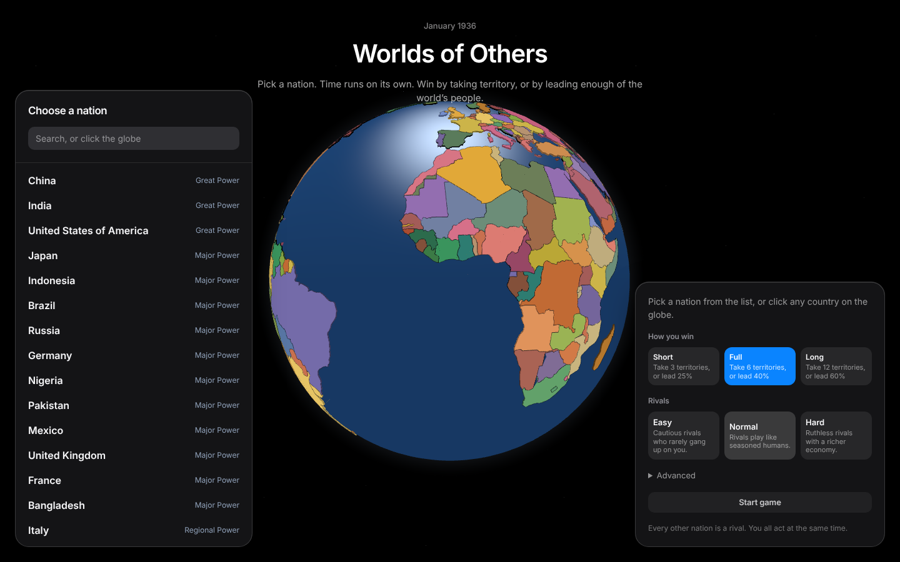).
2. **The clock starts the moment you press Start.** The introduction card is still open while a month passes every 20 seconds. After 40 seconds it is already May (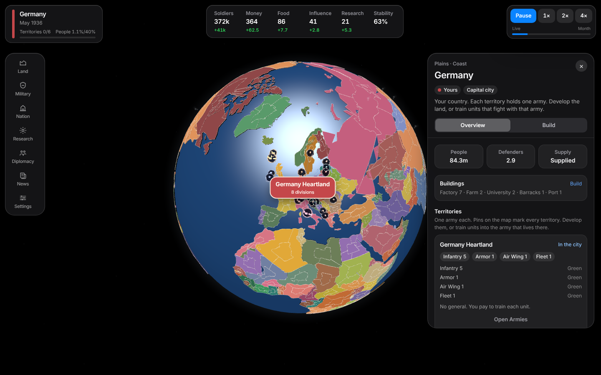).
3. The right panel opens with a wall of territory cards (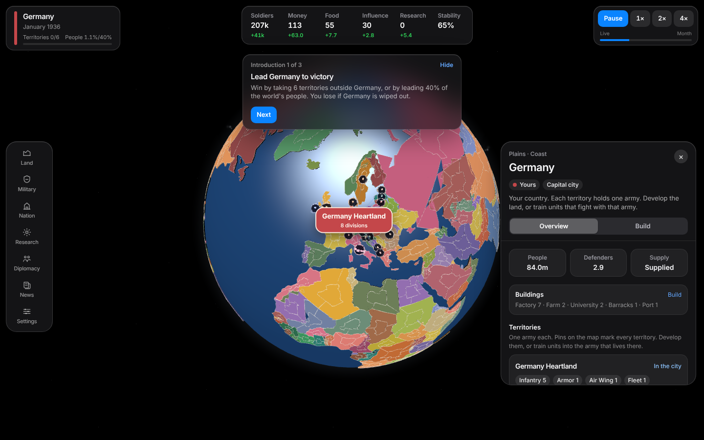).
4. Nothing happens by itself for a long time. In my long run money rose from 113 to 1,931 and research from 0 to 154 with nothing to spend them on that mattered.
5. To fight, you press Attack. The hint says "Declare war on a neighbor first" (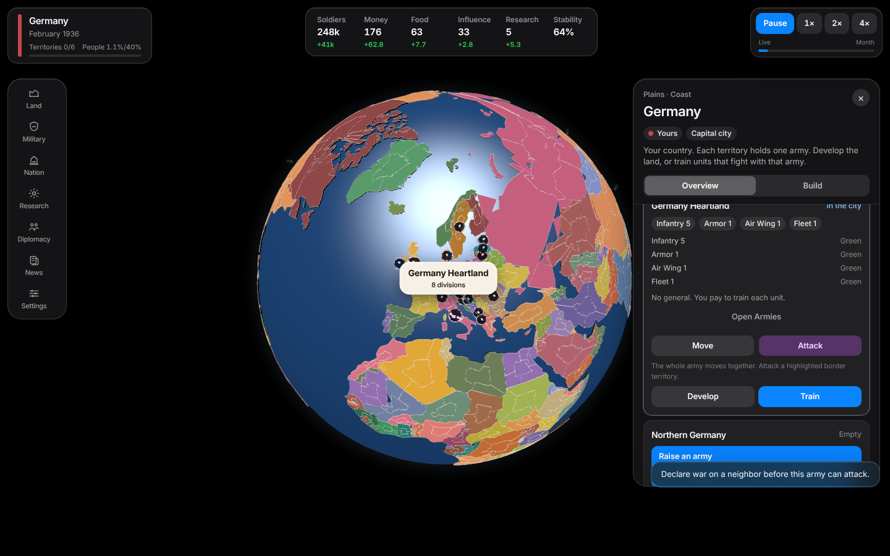). The Declare war button is not on that screen. It is inside Diplomacy → a country card → **Treaties** toggle (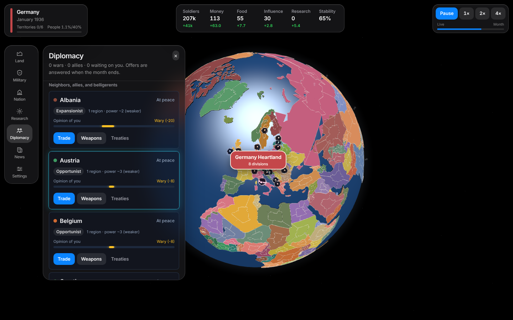). I had to read the source to find it.
6. When a battle finishes, the game pauses, plays a 5.5-second cutscene that moves the camera, and shows a banner. The cutscene title and the banner text overlap (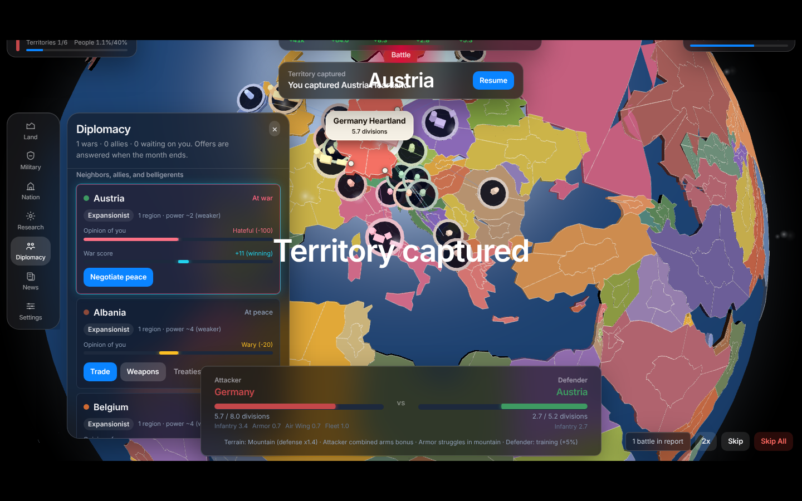). You then press Resume.
7. Meanwhile bots declare war on you and take your other territories. Four of Germany's five territories have no army, because the army sits in the capital. In my run Latvia, Switzerland and Romania took Germany apart in about six minutes of play, while Germany held 966 unspent money (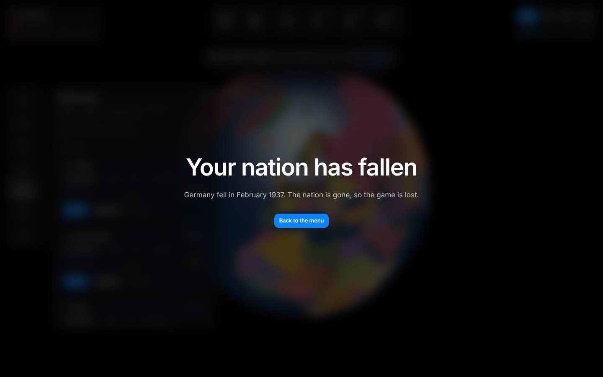).
8. Game over has no stats and no way to start again except "Back to the menu", and "Continue" then loads the dead game.

## Issues

IDs: **P** pacing/flow, **R** rules, **A** AI, **U** interface, **X** accessibility, **M** mobile, **F** performance, **S** robustness/security, **T** telemetry.

### Pacing and flow

| ID | Sev | Issue | Repro | Fix | Effort |
|---|---|---|---|---|---|
| P1 | Critical | Clock runs while the introduction is open (verified) | Start any game; wait 40s | Start paused; resume when the introduction ends | S |
| P2 | Critical | Every finished unit, war declaration, capture and loss hard-pauses and needs a Resume click (verified for war and capture; code for units, `realtime.ts:257-258`) | Queue 4 infantry at one site | Toast for good news; pause only for losses and wars on you; merge notices in one tick | S |
| P3 | High | Every battle you're in plays a ~5.5s cutscene that moves the camera and freezes the clock (verified, `BattleFX.tsx:19-21`) | Capture a territory | Cutscenes only for captures and losses; setting for All / Off; Esc skips | M |
| P4 | High | Cutscene title and pause banner overlap (verified, screenshot) | As P3 | Hide the banner while a scene plays | S |
| P5 | High | Long dead time: money, influence and research only arrive once per 20s month, and the first decision event is at month 21 (~7 minutes) (code, `pace.ts:4`, `events.ts:12-14`) | Wait | Month to 12s; first event at month 8 | S |
| P6 | Medium | Research tiers 4–6 (260–580) and most land upgrades cannot be reached in a 10–30 month game (code, `techTree.ts:41`) | Germany: tier 3 at month ~28 | Roadmap: compress tree | M |
| P7 | Medium | "Short" victory (3 territories) can be won in about a minute by a Great Power (code, `victory.ts:16-20`) | China vs Bhutan and Nepal | Roadmap: weight by territory value | S |

### Rules and engine bugs

| ID | Sev | Issue | Repro | Fix | Effort |
|---|---|---|---|---|---|
| R1 | High | You cannot retake a territory an enemy holds inside your own country: "Region is already yours" (code, `orders.ts:227`) though the globe highlights it | Lose a home territory, try to attack it | Allow attacks on foreign-held territory in your own country | S |
| R2 | High | Captures are not checked against the war state of the territory's holder: you can take land from a third country or an ally (code, `warfare.ts:206-208,264`) | Hold land inside another country, attack its neighbor | Only target territories held by a nation at war with the attacker | S |
| R3 | High | When a country falls, every territory claim inside it is cleared, including a third nation's. I captured Austria Heartland, then Italy took Austria, and my territory count went from 1 to 0 with no message (verified, `warfare.ts:77,400`) | As described | Keep other nations' claims; tell the player | M |
| R4 | High | Armies are always entrenched (+20% defence) in the live game: live moves never reach the month resolver that resets entrenchment (code, `resolveTurn.ts:134`) | Any battle report says "entrenched" | Mark an army as having acted when its march starts | S |
| R5 | Medium | New recruits inherit the army's full drill rank, so green units fight as Guard (code, `training.ts:12`) | Drill, then recruit | Weight rank by unit count | S |
| R6 | High | Base garrison is split across a country's territories, so a major power's non-capital territories are almost undefended (verified in play: Germany lost four territories in a row; code `warfare.ts:238-241`) | Let a bot attack a multi-territory nation | Garrison per territory plus capital bonus | M |
| R7 | Medium | Events can take your money below zero (code, `events.ts:136,184`), triggering desertion and instability | Pick an expensive event option while poor | Disable unaffordable options | S |
| R8 | Medium | You lose when your capital falls and you have no armies, even with other territories or units in training (code, `victory.ts:35-36`) | — | Defeat only when nothing is left to fight with | S |
| R9 | Medium | Soldiers above the cap vanish at month end, wasting "Embrace the Fervor" and bought manpower (code, `economy.ts:187`) | — | Roadmap | S |
| R10 | Medium | Rebels in your capital can end the game, and the notice says "An enemy took…" (code, `warfare.ts:356-358`) | High taxes | Roadmap | M |
| R11 | Low | Territories held by a dead nation stay claimed forever (code, `warfare.ts:51-69`) | — | Return them to the country owner | S |
| R12 | Low | Secession copies the old owner's soldiers and research (code, `warfare.ts:438-441`) | — | Roadmap | S |
| R13 | Low | Dead code from the old turn-based path (`store.endTurn`, `marches`, `turnTimer`, unused order branches) and most tests exercise it instead of the live game | — | Remove dead code; rewrite tests against `advance()` over time | M |

### AI

| ID | Sev | Issue | Repro | Fix | Effort |
|---|---|---|---|---|---|
| A1 | High | Bots cannot spend: each trains at one site, about 2 infantry a month, whatever its income. Hard's +15% income does nothing (code, `bot.ts:325-337`) | Watch China (+228/mo) as a bot | Several sites scaled by income; production multiplier by difficulty | M |
| A2 | High | No time to react: a bot's declaration is followed by attacks within ~4s plus 6–16s of marching, though the comment says the player gets a month (code, `bot.ts:478`) | Be declared on | Delay first attack ~1 month | S |
| A3 | Medium | Bots overestimate multi-territory defenders by up to 8× (code, `bot.ts:114-120`) and drill generals from turn 1; the player is never told | — | Match estimate to the new garrison rule | S |
| A4 | Medium | The anti-player coalition triggers only on population share (14%), which conquering small territories never reaches (code, `opinion.ts:49-53`) | Take 12 microstates | Also trigger on territories taken | S |
| A5 | Low | Bots never develop land, pass laws, spy or rebase (code) | — | Roadmap | M |

### Interface and feedback

| ID | Sev | Issue | Repro | Fix | Effort |
|---|---|---|---|---|---|
| U1 | Critical | Declare war is hidden behind Diplomacy → card → "Treaties" (verified) | Try to attack | Put a red button on the card and on the foreign country panel; give the Attack hint an action | S |
| U2 | High | Most things that happen to you are never shown: replies to proposals, research done, desertion, armies surrendering, deals defaulting. The toasts live in the unused `endTurn` (code, `store.ts:492-493`) | Propose a trade | Toast month results in the live game | M |
| U3 | High | Game over has no stats and no restart; the finished save stays, so Continue reopens it (verified) | Lose, go to menu, Continue | Show stats, New game, clear the save | S |
| U4 | High | "Start game" overwrites a save without asking; Continue does not say what it loads (code, `Setup.tsx:131-135`) | — | Confirm; show nation and date | S |
| U5 | High | Toasts cover the country panel's action buttons (code, `Chrome.tsx:127` vs `CountryPanel.tsx:99`) | Attack with a panel open, toast lands on it | Offset toasts | S |
| U6 | Medium | "Choose where to attack" hint is pinned at `top-28` and overlaps the HUD (verified in `17-late.png`) | Press Attack | Position below `--chrome-bottom` | S |
| U7 | Medium | HUD resource breakdown is clipped by the bar's overflow and hover-only (code, `HUD.tsx:105,209`) | Hover a resource | Remove the clipping | S |
| U8 | Medium | No march arrows: they are built from queued orders, but moves and attacks run live and never enter that list (code, `Globe.tsx:572-582`) | Order an attack | Draw from each army's live march | M |
| U9 | Medium | Armies on the globe cannot be clicked (code, `Globe.tsx:173,240`) | Click an army marker | Roadmap | M |
| U10 | Medium | Setup: the globe does not turn to the nation you pick (code) | Pick Brazil | Turn the camera | S |
| U11 | Medium | Same thing, many names: territory / district / city / muster; Train vs Drill; pact vs peace pact; "1 countries" (verified on Nation panel) | — | Pick one word each | M |
| U12 | Medium | Guide hides all tips for good on "Hide"; the "what to do" prompt almost never shows (code, `Guide.tsx`) | Hide, then play | Roadmap: guided first war | M |
| U13 | Medium | Event modal colours effects wrongly (e.g. "opinion -10" green) (code, `EventModal.tsx:64`) | — | Roadmap | S |
| U14 | Medium | Opening the TerritoriesPanel from a card does not scroll to that territory (code) | — | Roadmap | S |
| U15 | Low | News log keeps 300 world entries, so your own events scroll out within months (code, `helpers.ts:173-176`) | — | Roadmap | S |
| U16 | Low | The first screen's right panel shows up to 8 territory cards, each repeating the same help text (verified) | — | Roadmap | M |

### Accessibility

| ID | Sev | Issue | Fix | Effort |
|---|---|---|---|---|
| X1 | High | Attacking needs the mouse on the 3D globe; no keyboard route | Roadmap: target list | L |
| X2 | High | EventModal and GameOver have no dialog role and don't take or trap focus (code) | Role and focus for EventModal (this PR) | S |
| X3 | Medium | Shortcuts fire with Ctrl/Cmd held, on key repeat, and behind dialogs; Ctrl+R/D/T/L toggle panels (code, `App.tsx:17-47`) | This PR | S |
| X4 | Medium | Small, low-contrast text: many 10–12px labels at white/40–45 on glass (estimated ~2.8–4.4:1) | Roadmap | M |
| X5 | Medium | Reduced motion only partly honoured (Framer animations, scroll, rings) | Roadmap: `MotionConfig` | S |
| X6 | Medium | No live regions for toasts or the banner; colour-only owner map; 27 colours for ~175 nations | Roadmap | M |

### Mobile

| ID | Sev | Issue | Fix | Effort |
|---|---|---|---|---|
| M1 | High | Setup is unusable at 390px: two columns of ~150px, text overlaps, no Start button in view (verified, 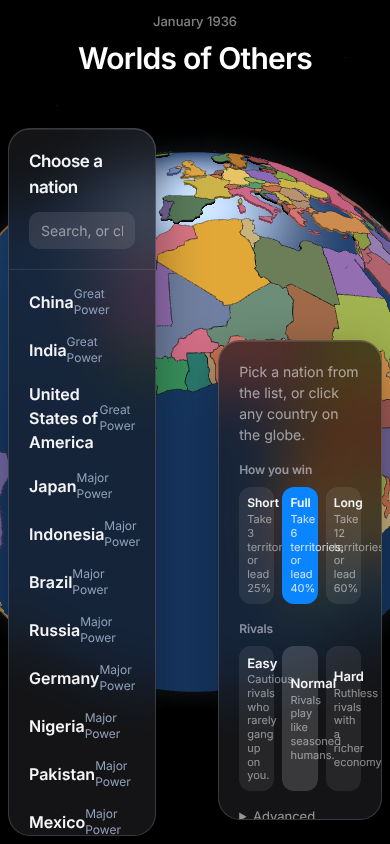) | Stack at under 640px (this PR) | S |
| M2 | High | In-game panels have no usable layout on phones in landscape; touch targets 11–28px (code) | Roadmap | L |

### Performance

| ID | Sev | Issue | Fix | Effort |
|---|---|---|---|---|
| F1 | High | `structuredClone` of the whole state and an app-wide re-render 10 times a second (code, `realtime.ts:292`, `App.tsx:80`) | Roadmap: in-place update or Worker | L |
| F2 | High | Economy recomputed in every button instance via `usePlayerView` (code, `hooks.ts:18-39`) | Cache per game object (this PR) | S |
| F3 | Medium | Map pins and accessors rebuilt every tick (code, `Globe.tsx:738-817,505-535`) | Roadmap | M |
| F4 | Medium | Fixed 28px backdrop blur over a redrawn WebGL canvas; ~1.8MB single bundle; Vite dev cold load was 7.4s in the sandbox | Roadmap | M |
| F5 | Low | Autosave `JSON.stringify` every 5s and on each order | Roadmap | S |

### Robustness and security

| ID | Sev | Issue | Fix | Effort |
|---|---|---|---|---|
| S1 | High | No error boundary: any render error gives a black screen, and the bad save reloads on every visit (code) | Boundary with Delete save (this PR) | S |
| S2 | Medium | `localStorage.getItem` at import time is unguarded and can throw (`store.ts:261`); settings are merged unchecked, a bad `simSpeed` freezes the sim (code) | This PR | S |
| S3 | Medium | `migrate.ts` leaves `nextEventTurn` missing in old saves, so events stop forever (NaN compare); a removed pending event id crashes (code) | This PR | S |
| S4 | Low | Globe tooltips build HTML strings from names (code, `Globe.tsx:551`); data is static or from the player's own save | Escape | S |
| S5 | Low | Fonts load from Google Fonts (IP leak, offline failure) | Self-host | S |
| S6 | Low | Bot test "send the player at most one new proposal a month" times out at 5s (verified) | Longer timeout (this PR) | S |

### Telemetry

| ID | Sev | Issue | Fix | Effort |
|---|---|---|---|---|
| T1 | High | None at all: no analytics, no error reporting, no `window.onerror`. You cannot see where players quit | Add events: nation picked, first war, first capture, pauses per session, quit point, outcome, errors | M |

### Not applicable
Account creation, login, social features, monetization, in-app purchases, multiplayer and server networking do not exist. The README notes multiplayer as a future option; the deterministic engine would support it.

## What this PR fixes

Checked by unit tests (`npm test`, 154 pass) and by replaying the game in the browser after the changes. In the replay the game started paused with the introduction open, queuing three infantry caused no pause, **Declare war** was one click from the nation card, and the capture played one scene instead of a pause plus banner. The phone-size setup screen now fits with Start in view.

| Fixed | IDs |
|---|---|
| Pacing and interruptions | P1, P2, P3, P4, P5 (month 20s → 12s, first event month 21 → 8, then every 12) |
| Rules | R1, R2, R3, R4, R5, R6, R7, R8, R11 |
| AI | A1, A2, A3, A4 |
| Interface | U1, U2, U3, U4, U5, U6, U8, U10, "1 countries" in U11 |
| Accessibility | X2 (event dialog and game over; focus and role), X3 |
| Mobile | M1 |
| Performance | F2 |
| Robustness | S1, S2, S3, S6, part of R13 (`endTurn` and the turn timer removed) |

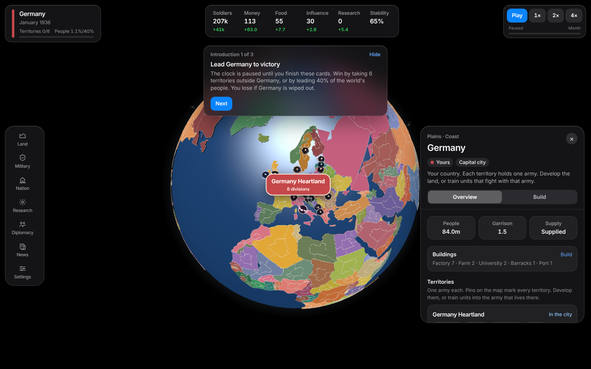
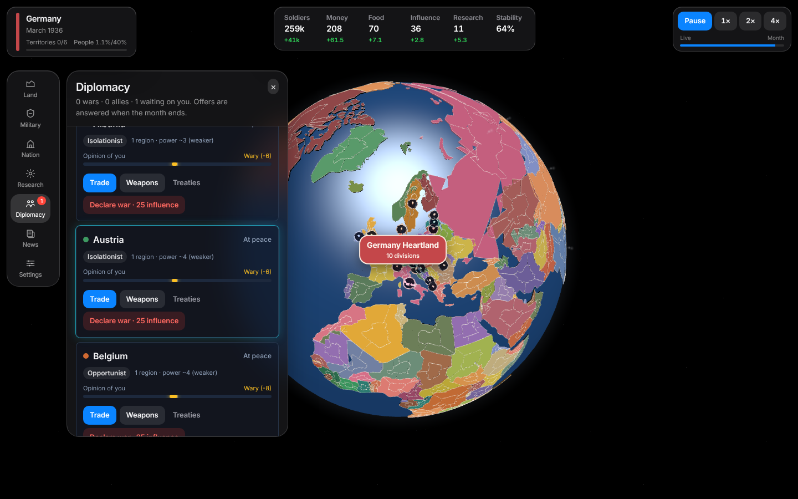
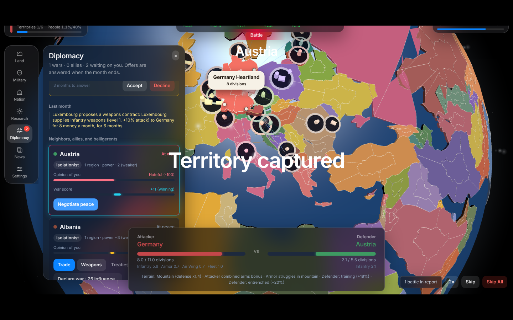
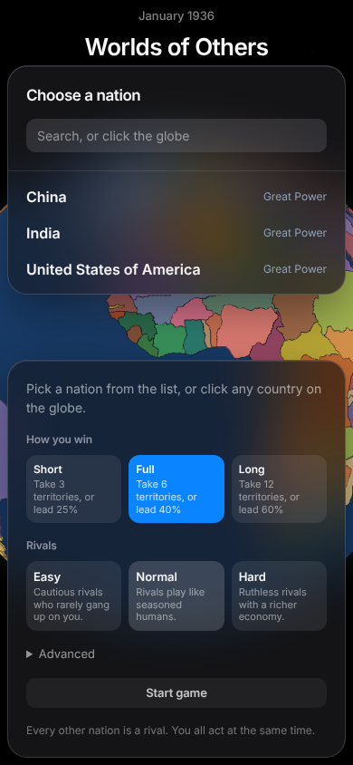

Not fixed here, and still open: P6, P7, R9, R10, R12, most of R13 (the monthly path in `resolveTurn` and the `marches` store fields remain), A5, U7, U9, U11 (naming), U12–U16, X1, X4–X6, M2, F1, F3–F5, S4, S5, T1. The "Territory captured" title and the "Austria" label in the battle scene still sit on top of the HUD while the scene plays.

Two changes worth knowing about: the first decision event now comes at month 8 instead of 21, which partly reverses commit 999540d, and a garrison is now a flat 1 defender per territory plus the country's barracks and workforce shared out. Both are numbers to tune in play.

## What would make it more fun

### Cut or merge
- **Fleets:** 0.03 attack per money, no sea control, ignored on land. Cut, or give them blockades.
- **Housing:** costs upkeep, produces nothing. Cut or give it yield.
- **Depots and road supply:** 4-step supply range rarely matters at this scale. Fold into barracks.
- **Paid drilling vs generals:** pick one. Free drilling by generals makes paid drilling pointless.
- **Three overlapping "+x% attack" systems:** weapons contracts, foreign arms, tech bonuses.
- **Population-share victory:** unreachable (40% is ~3.2 billion people) and only feeds the coalition.
- **Tech tiers 4–6** and the sea-invasion flag nothing reads.
- **The old turn-based path.**

### Add
- **Merge armies and joint attacks.** Each training site makes its own army, so building everywhere splits your force. This is the single most useful new mechanic.
- **Occupation that pays.** Today seizing part of a country changes nothing economically. Captured territory should carry income and workforce and be worth defending.
- **Goals between paydays.** Seasonal objectives ("hold Austria 3 months", "win with combined arms") that pay influence, research or a general.
- **Generals worth earning.** Traits are all "General" today. Earn them from battles and events.
- **A threat that builds.** A coalition that reacts to conquest, rivals that mass on your border, a first event by month 8.
- **A decision during battle.** Choose a tactic per attack so fights are not just a number race.
- **Research that trickles** into a chosen tech every month instead of a lump you must save for.
- **A guided first war** in the introduction: declare, train, attack, with the UI highlighting each step.
- **Pacing target:** a typical game of 15–25 minutes, with something to decide every 20–30 seconds and a pause only when something bad happens.

### Technical
Run the simulation in a Web Worker, cache map pins, self-host fonts, add `MotionConfig`, error reporting and analytics.
